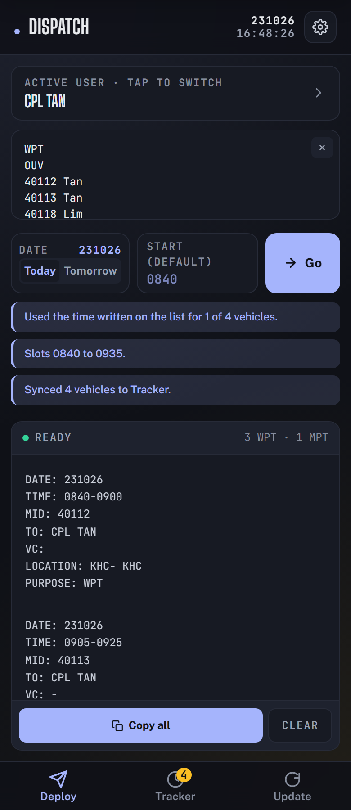
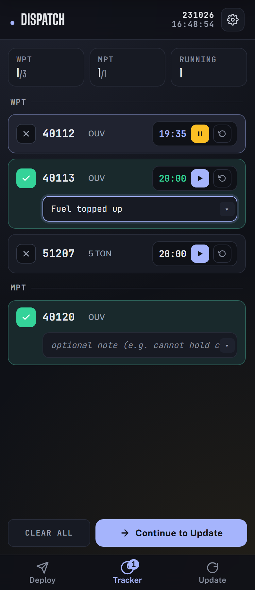
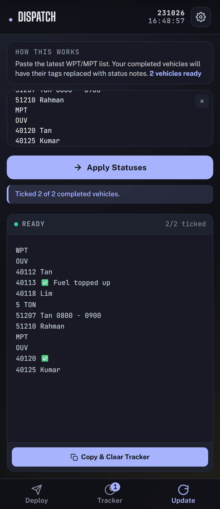

# Dispatch

Turn the WPT / MPT vehicle list into copy-paste dispatch blocks, time each WPT, and tick off completed vehicles. Paste the list once: Dispatch picks out your vehicles, assigns the time slots, keeps a countdown for each one, and writes the updated list back with the finished ones marked. Installable as a PWA, and works fully offline after the first visit.


<p align="center">
  
  
  
</p>
<p align="center"><sub>Deploy, Tracker and Update. Shown with a made-up vehicle list.</sub></p>

## At a glance

| | |
| --- | --- |
| **Live** | https://dispatchsaf.ethantam.dev |
| **Hosting** | Cloudflare Pages, connected to this repository; every push to `main` deploys (`npm run build`, output `dist/`) |
| **Data** | Stays in the browser (`localStorage`). No server, no account. |
| **Run locally** | `npm install && npm run dev`, then open http://localhost:5173 |
| **Source** | [gitlab.com/eatentam/dispatchsaf](https://gitlab.com/eatentam/dispatchsaf) |

Settings: none. There are no secrets or environment variables; the only network call is the optional feedback button.

## Features

- **Deploy** — Paste a WPT/MPT vehicle list, pick a date (today/tomorrow) and optional custom start time. Generates formatted dispatch blocks (`DATE`, `TIME`, `MID`, `TO`, `VC`, `LOCATION`, `PURPOSE`) ready to copy-paste. Each block is individually copyable.
- **Tracker** — Vehicles auto-sync from the Deploy page. Each WPT gets a 20-minute countdown timer, each MPT a 30-minute slot. Start/pause/reset timers, mark vehicles done, add notes (with saved presets).
- **Update** — Paste a fresh vehicle list. Completed vehicles from the Tracker get their tags replaced with ✅ + note. Copy the result and the tracker clears for the next round.
- **Settings** — Manage users (name, rank, aliases), status code blocklist (words after a MID that aren't names), theme (light/dark/auto), auto-generate on paste, tracker visibility, and JSON backup/restore.
- **PWA** — Installable on mobile and desktop. Service worker caches everything for offline use. Update banner appears when a new version is deployed.

## Getting started

```sh
# Install dependencies
npm install

# Start dev server (http://localhost:5173)
npm run dev

# Run tests
npm test

# Type-check
npm run typecheck

# Lint
npm run lint

# Production build (outputs to dist/)
npm run build

# Preview production build locally
npm run preview
```

## Project structure

```
dispatchsaf/
├── index.html              # App shell — all DOM structure, no inline logic
├── public/                 # Static assets served as-is
│   ├── manifest.json       # PWA manifest
│   ├── sw.js               # Service worker (offline cache)
│   ├── icon-192.png        # App icon
│   └── icon-512.png        # App icon (large + maskable)
├── src/
│   ├── app.ts              # Entry point — boots the app
│   ├── types.ts            # TypeScript types for the whole app
│   ├── lib/
│   │   ├── storage.ts      # localStorage helpers
│   │   ├── time.ts         # Date/time formatting and parsing
│   │   ├── parse.ts        # Vehicle list parsing (MIDs, categories, tags)
│   │   ├── format.ts       # Dispatch block generation
│   │   ├── tracker.ts      # Tracker logic (timers, status, notes)
│   │   ├── state.ts        # App state loading, persistence, backup
│   │   └── dom.ts          # DOM helpers (toast, confirm, copy, status)
│   ├── ui/
│   │   ├── settings.ts     # Settings modal (users, blocklist, prefs)
│   │   ├── deploy.ts       # Deploy page logic
│   │   ├── tracker.ts      # Tracker page UI
│   │   └── update.ts       # Update page logic
│   └── styles/
│       ├── tokens.css      # Design tokens (colors, fonts, easing)
│       ├── base.css        # Reset, keyframes, utilities, scrollbar
│       ├── components.css  # Header, buttons, inputs, modals, toast
│       ├── pages.css       # Page-specific styles (tracker, update)
│       └── main.css        # Imports all style modules
├── tests/
│   ├── time.test.ts        # Time utility tests
│   ├── parse.test.ts       # Vehicle list parsing tests
│   ├── format.test.ts      # Dispatch generation tests
│   ├── tracker.test.ts     # Tracker logic tests
│   └── update.test.ts      # Status application tests
├── public/_headers         # Cloudflare Pages security headers + cache rules
├── vite.config.ts          # Vite config (build, dev server, test)
├── tsconfig.json           # TypeScript config (strict mode)
├── eslint.config.js        # ESLint config
├── .prettierrc             # Prettier config
└── package.json
```

## How it works

### Parsing

The vehicle list parser (`src/lib/parse.ts`) handles messy real-world input:

1. Normalises line endings, strips emoji markers (✅❌), expands `===` separators
2. Inserts line breaks before 5-digit MIDs, known vehicle categories, and WPT/MPT headers
3. Splits into lines, tracks the current section (WPT/MPT) and category
4. For each MID line, extracts embedded time ranges (e.g. `0800 - 0900`) and the remaining text
5. Extracts a person's name by stripping blocklisted status codes, noise words, dates, and parenthesised content

### Dispatch generation

`src/lib/format.ts` takes a parsed list and a user, then:

1. Filters vehicles matching the user (by name or alias, case-insensitive, word-boundary aware)
2. Assigns time slots: WPT = 20 min, MPT = 30 min, 5 min gap between vehicles
3. Overrides with embedded times when present on the list
4. Formats each block as a 7-line text block
5. Returns blocks + metadata (counts, overflow, tracker-ready vehicle list)

### Tracker

`src/lib/tracker.ts` manages vehicle timers:

- Each WPT vehicle gets a 20-minute countdown (1,200,000 ms)
- Timers can be started, paused, and reset
- A 1-second interval checks for expired timers and auto-marks them done
- Notes can be added to done vehicles, with up to 8 saved presets

### State

All state lives in `localStorage` under the `dispatch.*` key prefix. The state module (`src/lib/state.ts`) handles loading, normalising, persisting, and JSON backup/restore.

## Design system

- **Fonts**: Big Shoulders Display (headings), Public Sans (body), JetBrains Mono (data/labels)
- **Colors**: CSS custom properties with light/dark themes via `[data-theme]` attribute
- **Motion**: Custom easing curves (`--ease-out`, `--ease-out-strong`, `--ease-snappy`), all animations under 350ms
- **Responsive**: Mobile-first, max-width 480px centered on desktop
- **Accessibility**: Full keyboard navigation, ARIA labels, `prefers-reduced-motion` support, focus-visible rings

## Deploy

Pushes to `main` automatically deploy via Cloudflare Pages. The build command is `npm run build` and the output directory is `dist/`.

The service worker cache version (`dispatch-v12` in `public/sw.js`) should be bumped on each deploy so installed apps pick up the update.

## License

Private project.
